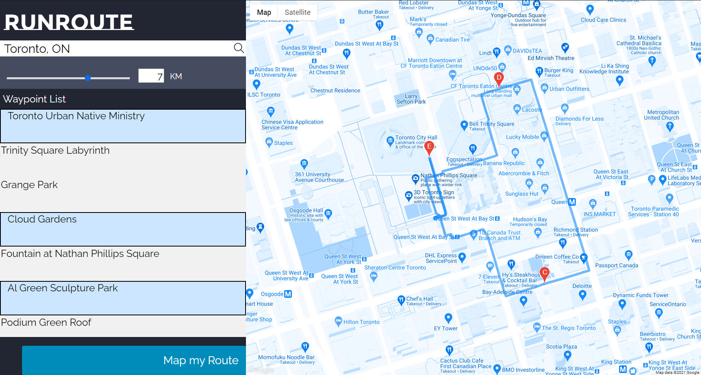

# RunRoute

**[www.runroute.app](https://www.runroute.app)**

RunRoute is a route planner for runners who start from home. Your location is both the
beginning and the end of the route — pick the nearby parks, sights and cafés you want to
pass, and RunRoute threads them into a door-to-door running loop.



## Features

- **Door-to-door loops** — every route starts and ends at your address (or your current location via geolocation).
- **Places worth passing** — search nearby parks, attractions, cafés and gyms within an adjustable radius.
- **Drag to customize** — reshape any part of the generated route directly on the map.
- **Distance & time** — live route stats in km and miles, with an estimated time at your chosen pace.
- **GPX export** — download the loop for Garmin, Strava, Komoot, etc.
- **Shareable links** — copy a URL that rebuilds the exact loop (start, radius, categories and stops).

## Stack

Plain HTML/CSS/JS, hosted on GitHub Pages. Uses the Google Maps JavaScript API
(Maps, Places, Directions, Geocoding) and the browser Geolocation API. No build step:
edit, commit, push to `master` and GitHub Pages deploys it.

## Project layout

```
index.html                  Landing page
404.html                    Not-found page
views/html/                 About, Contact, Application pages
scripts/app.js              Application logic (map, search, routing, GPX, share links)
content/css/site.css        Landing/About/Contact styles
content/css/app.css         Application styles
content/images/             Illustrations, demo GIFs, favicon
```

`scripts/mapUI.js`, `scripts/sliderUI.js`, `content/css/style.css` and
`content/css/application_style.css` are the pre-2026 implementation, kept for reference;
no page references them anymore.
